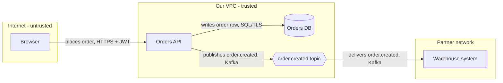

# Architecture diagrams

A diagram answers one question for one reader. Pick the type from the question, write it as text so it can be
reviewed in a pull request, and keep it small enough to read in ten seconds.

## Procedure

1. **State the question.** Write it as a sentence: "Who talks to the billing system?", "What happens when a payment
   fails?", "Where does PII flow?" If the user can't say, ask, or pick the most likely question and state it. If you
   have two questions, you need two diagrams.
2. **Pick the type from the question.**

   | Question | Diagram | Mermaid keyword |
   |---|---|---|
   | What is the system and who or what uses it? | C4 context | `C4Context` |
   | What are the deployable pieces and how do they talk? | C4 container | `C4Container` or `flowchart` |
   | What is inside one container? | C4 component | `flowchart` with a subgraph |
   | What happens, in order, between actors? | Sequence | `sequenceDiagram` |
   | Where does this run? Which network, region, cluster? | Deployment | `flowchart` with nested subgraphs |
   | Where does data move and where is it stored? | Data flow | `flowchart LR` |
   | What are the tables or entities and how do they relate? | ERD | `erDiagram` |
   | What states can this thing be in and what moves it? | State machine | `stateDiagram-v2` |
   | What are the steps and decisions of a process? | Flowchart | `flowchart TD` |

3. **Gather real names.** Read the code, config or infra files. Use the names the code uses. Don't invent components
   to make the picture tidy; mark guesses with a `?` in the label and tell the user.
4. **Draft in Mermaid.** For syntax, read `references/mermaid-cheatsheet.md`. Put the diagram in a fenced
   ```` ```mermaid ```` block in the doc, with a one-line caption above it stating the question it answers.
5. **Apply the rules below**, then split or trim until they hold.
6. **Verify it renders.** If `mmdc` (`npx -y @mermaid-js/mermaid-cli -i in.mmd -o out.svg`) or a Mermaid preview is
   available, run it. If not, check syntax by hand against the cheatsheet and say the diagram was not rendered.

## Rules

- One question per diagram. A title or caption that names it.
- At most about 12 nodes. Past that, split by level (context, then container) or by flow (happy path, failure path).
- Flows read left to right (`flowchart LR`); hierarchies and processes top to bottom.
- Label every arrow with what flows: verb plus data, and the protocol where it matters ("sends order, HTTPS",
  "publishes `order.created`, Kafka"). An unlabelled arrow is a bug.
- Arrow direction is the direction of the call or data, not of dependency, unless the legend says otherwise.
- Mark trust boundaries (internet, VPC, tenant, third party) with subgraphs or boundaries, and show where
  authentication happens when it matters.
- Legend whenever shape, color or line style carries meaning. Prefer few styles: external systems grey, data stores
  as cylinders `[( )]`, queues labelled as queues. Don't rely on color alone.
- Names match the code and the docs. Show technology in the node ("Orders API, Go") at container level and below.
- Mix levels never: a context diagram has no databases; a container diagram has no classes.
- Show the failure path in its own sequence diagram when the failure behaviour is the point.

## Tool choice

- Mermaid by default: renders on GitHub, GitLab, and most docs tools, and diffs as text.
- D2 when layout quality matters, for large or nested diagrams, or when you want themes and icons. Needs a build step.
- PlantUML when the toolchain already has it or you need UML specifics. Structurizr DSL when you maintain a C4 model
  with several views generated from one source of truth.
- Excalidraw or a whiteboard for early exploration. Redraw as code once it stabilises.

## Example

Question: "How does a browser order reach the warehouse, and where is the trust boundary?"



Legend: cylinder is a data store, hexagon is a message topic, boxes group by trust zone.

## Common failures

- **Everything in one diagram:** 30 nodes, three questions. Split.
- **Unlabelled or "uses" arrows:** say what moves: "reads user profile, gRPC".
- **Boxes with no owner or technology:** at container level, add the tech. If a box is a team's system, say so.
- **Mixed abstraction:** a class next to a data center. Redraw per level.
- **Decorative color:** a red box that means nothing. Remove it or add a legend entry.
- **Diagram contradicts the code:** it was drawn from memory. Check against the repo before publishing.
- **Syntax that only renders in one tool:** keep to the cheatsheet; C4 Mermaid is experimental, so fall back to
  `flowchart` if the target renderer is old.

## Done check

- [ ] The diagram answers one stated question, shown as a title or caption.
- [ ] 12 nodes or fewer, or split into linked diagrams.
- [ ] Every arrow is labelled with what flows (and protocol where relevant).
- [ ] Trust boundaries and external systems are marked.
- [ ] A legend exists if shape or color means anything.
- [ ] Names match the code; guesses are marked.
- [ ] It rendered, or you said it wasn't rendered.

For Mermaid syntax of each diagram type, read `references/mermaid-cheatsheet.md`.
