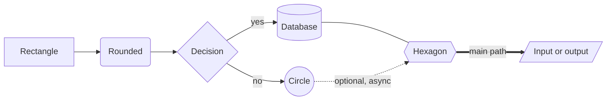
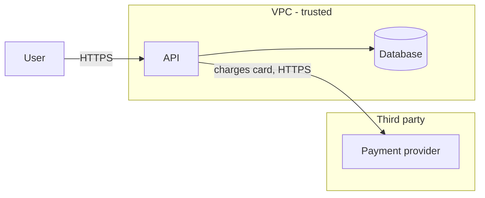
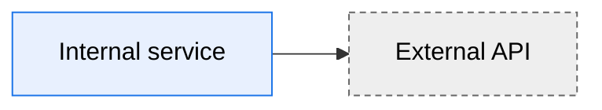
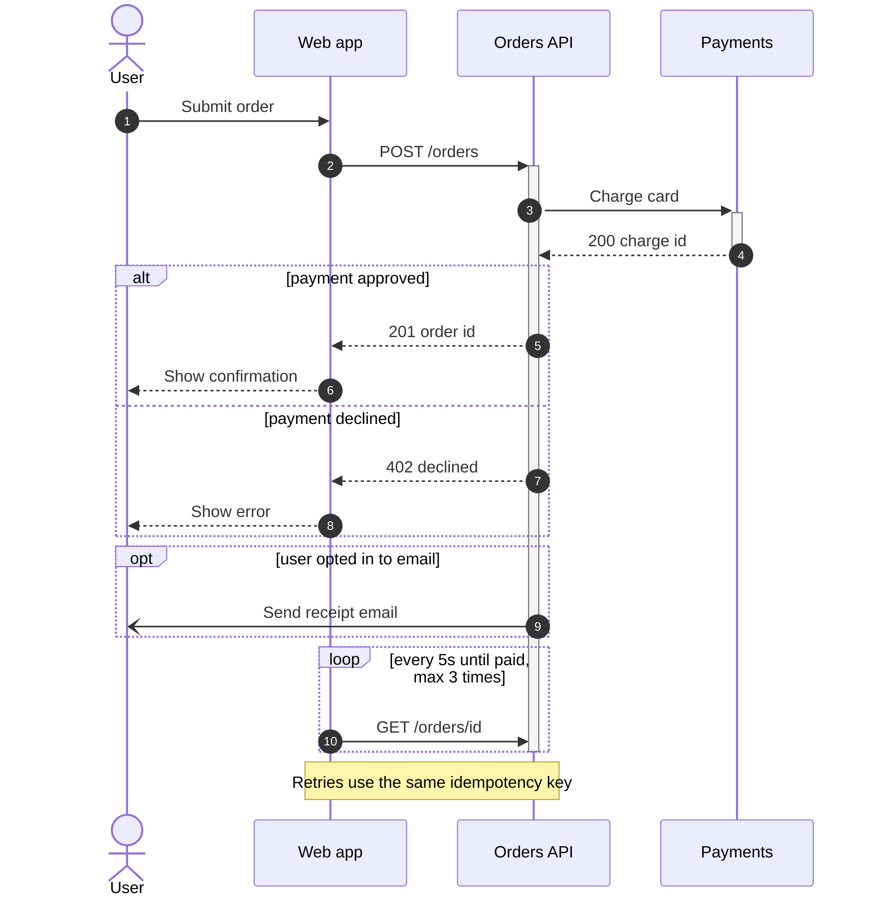
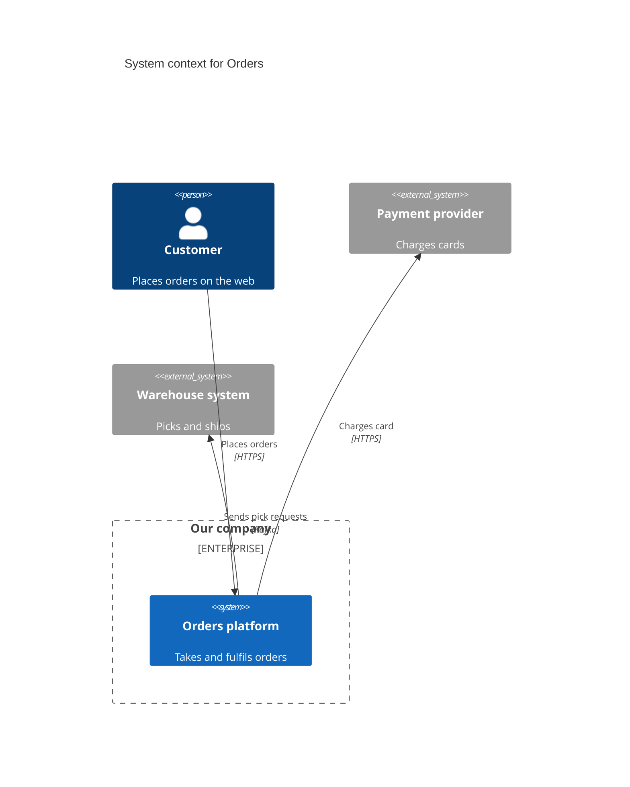
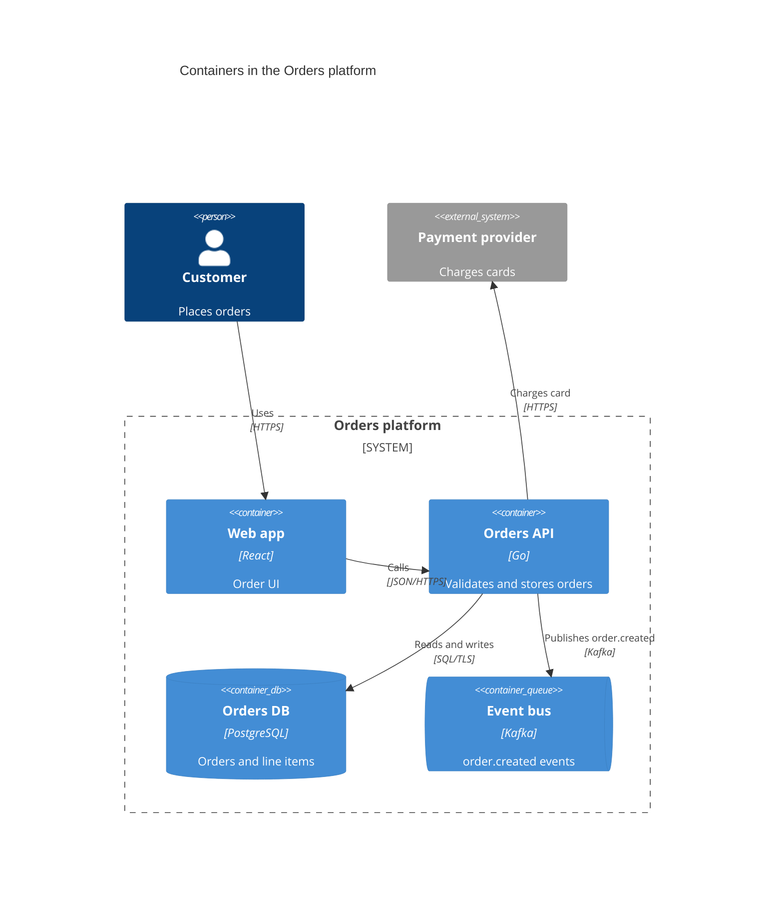
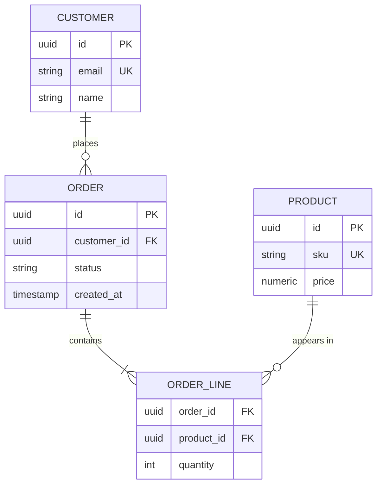
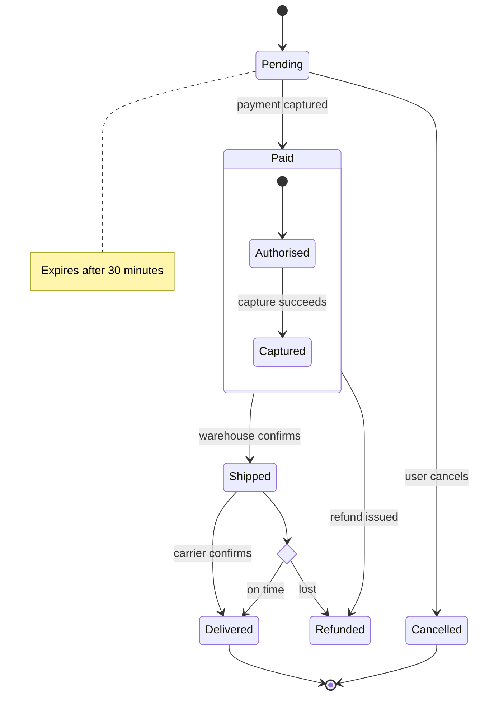

# Mermaid cheatsheet

Conservative syntax that works in Mermaid v10 and v11. Quote any label containing parentheses, brackets, commas,
colons or `#` with double quotes. Avoid the words `end` (lowercase) as a bare node label; write `End` or quote it.
Not verified with a renderer in the authoring environment; run `npx -y @mermaid-js/mermaid-cli -i x.mmd -o x.svg`
when you can.

## Flowchart

- Direction: `TD` (top down), `LR`, `RL`, `BT`.
- Shapes: `[ ]` box, `( )` rounded, `{ }` decision, `[( )]` cylinder, `(( ))` circle, `{{ }}` hexagon,
  `[/ /]` parallelogram.
- Arrows: `-->` solid, `-.->` dotted, `==>` thick, `---` no arrowhead. Label with `-->|text|` or `-- text -->`.
- Comments: a line starting with `%%`.

### Subgraphs as boundaries

- `subgraph id [Title]` ... `end`. Subgraphs nest. Keep edges node to node; edges to a subgraph id work but behave
  oddly with `direction`.
- `direction` inside a subgraph is ignored if any node in it links outside the subgraph.

### Styling and legend

Mermaid has no legend element. Write the legend as a sentence or table under the diagram.

## sequenceDiagram

- Arrows: `->>` solid with head (request), `-->>` dashed (response), `-)` async, `-x` lost message.
- `activate X` / `deactivate X`, or shorthand `+` after the arrow on the call and `-` on the reply. Every `+` needs a
  matching `-`.
- Blocks: `alt`/`else`/`end`, `opt`/`end`, `loop`/`end`, `par`/`and`/`end`, `critical`/`option`/`end`,
  `rect rgb(240,240,240)`/`end`.
- Notes: `Note right of A: text`, `Note over A,B: text`.
- `participant X as Label` for readable names; `actor` draws a person.

## C4 (experimental in Mermaid)

C4 diagrams in Mermaid are marked experimental. Layout is automatic and can be awkward; tune it with
`UpdateLayoutConfig`. If the renderer is old or the layout is poor, draw the same content as a `flowchart`.

### C4Context

### C4Container

Elements: `Person`, `Person_Ext`, `System`, `System_Ext`, `SystemDb`, `Container`, `ContainerDb`, `ContainerQueue`,
`Component`, `Container_Boundary`, `System_Boundary`, `Enterprise_Boundary`, `Boundary`. All take
`(id, "label", "technology", "description")` where technology is omitted for `Person` and `System`.
Relations: `Rel(from, to, "label", "technology")`, `BiRel`, `Rel_D`, `Rel_U`, `Rel_L`, `Rel_R` to bias direction.
`C4Component` works the same way with `Component(id, "name", "tech", "desc")` inside a `Container_Boundary`.
Strings must be double-quoted; do not put double quotes inside them.

## erDiagram

- Cardinality, left side then right: `|o` zero or one, `||` exactly one, `}o` zero or more, `}|` one or more.
  Combine with `--` (identifying) or `..` (non-identifying): `A ||--o{ B : label`.
- The label after the colon is required; quote it if it has spaces.
- Attribute format: `type name [PK|FK|UK] ["comment"]`. Entity names without spaces, or quoted.

## stateDiagram-v2

- Transition: `A --> B : trigger [guard] / action` as plain label text.
- `[*]` is start or end. `state X { ... }` nests. `<<choice>>`, `<<fork>>`, `<<join>>` for branching.
- Use `state "Long name" as id` when the label has spaces.
- Keep a state's composite block and its outer transitions consistent; a transition to a nested state needs the
  nested id to be unique.

## Pitfalls

- A label with `(`, `)`, `[`, `]`, `{`, `}` or `:` inside a flowchart node needs quotes: `a["Orders (v2)"]`.
- Node ids can't contain spaces; use `snake_case` ids and put the display text in the brackets.
- Don't name a node `end`, `graph` or `subgraph`. An id starting with `o` or `x` right after an edge, as in
  `A --- orders`, is read as a circle or cross edge end; capitalise the id or put a space after the arrow.
- Long labels: use ` ` for line breaks in flowchart labels.
- GitHub renders Mermaid in Markdown; some older GitLab and docs tools pin an old Mermaid, which can lack C4 or
  newer shapes.
